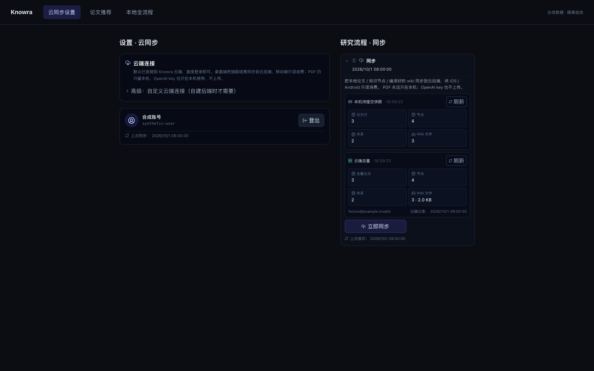
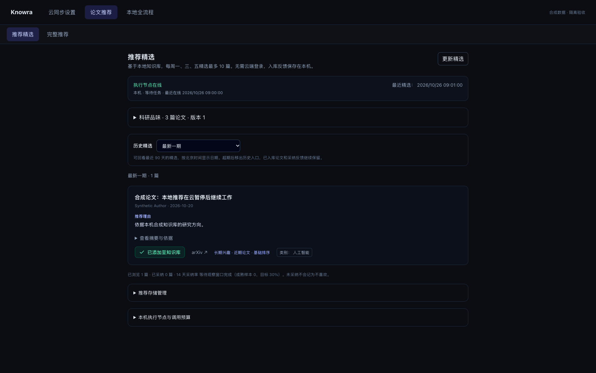
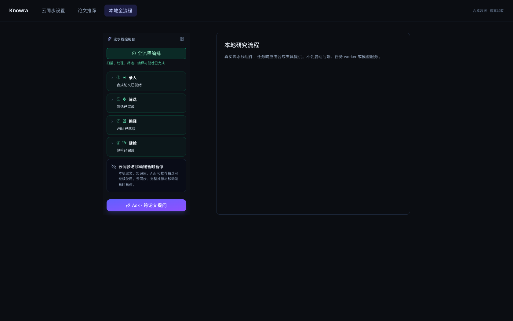

# 云能力冻结验收（2026-10-28）

云同步、鉴权刷新、完整推荐和远端 worker 默认暂停；本机研究流程、推荐精选、模型客户端及既有状态保留。没有读取、备份、修改或迁移日常研究数据，没有停止用户服务，没有操作订阅、云资源或移动发布。

## 版本与环境

- 新分支 `codex/freeze-cloud-20261028`；新 worktree 从 freshly fetched `origin/main` 的 `1b61ecf66634642ee8ad4f800c10313fee74e0c3` 建立。上一轮 PR #32 已核实合并。
- **受测代码提交：`333ccb76e9e4dc709a6f79883ed3407b73603542`。** 真实启动快照 316 个文件及专项改后快照 119 个文件的 SHA-256 均与此提交逐字节一致；报告中的 `source_head` 是验收捕获时尚未提交的基线，`verified_code_commit` 是校验后的实际代码提交。后续仅增加本报告、合成证据及开发日志链接。
- Python 3.12.13（独立 `backend/.venv`）；Node 24.14.1（工作区 `.cache/runtime/`）；Vite 8.0.10；TypeScript 6.0.3；macOS Chrome 临时 profile。未复制其他 worktree 的环境或数据。
- [机器可读检查摘要与源码哈希](verification.json)、[完整合成交互结果与图片哈希](cloud-acceptance.json)。报告不包含真实数据、凭据或用户运行目录。

## 前后图片

下列 4 张 1680×1050 原图使用同一合成夹具和真实生产 React 组件；导航外壳为隔离验收页面，不是用户日常页面。全部业务 API 都被 mock。修改前观察到鉴权刷新和云状态请求，但请求只命中合成响应，没有访问外网。

| 修改前：旧登录态显示同步入口 | 修改后：稳定暂停，不启动联网逻辑 |
| --- | --- |
|  |  |

| 保留本地推荐精选 | 本地全流程成功，不要求云登录 |
| --- | --- |
|  |  |

图片保留原始像素，没有文本或 EXIF 元数据；合成账号与论文不对应真实用户或研究库。

## Definition of Done

| 条件 | 实际结果 |
| --- | --- |
| 单一默认冻结策略，旧环境/配置不能启用 | 前后端共享 `cloud-capabilities.json`；布尔 `false`，无环境或存储覆盖；缺失/非法后端策略拒绝启用 |
| 自动与直接云入口均不联网 | 改后 8 组交互、31 个直接入口通过；鉴权、状态、同步、续传、快照、签名上传及远端 worker 均被阻断；外部请求尝试 0 |
| 旧状态不被清理 | 旧登录、过期待续传、损坏待续传、新 profile、页面切换和计时推进均覆盖；9 组保留断言，每组 9 键原值一致，写入/删除/clear 为 0 |
| 冻结不改本地数据 | 合成 SQLite 行、PDF/Wiki/图片/配置占位字节、目录清单逐项校验；重复请求冻结接口后文件 SHA-256 和数据库逻辑行不变，数据依赖与配置读取未执行 |
| 本地能力保留 | 推荐精选、焦点/反馈、本地 worker 启动、模型配置/测试客户端继续使用本地 API；真实流水线组件同 tick 双击只提交一次，离开/返回运行中页面不恢复云同步 |
| 后端拒绝早于副作用 | 同步 API 在 DB 依赖前返回 `403 cloud_disabled`；云模式在配置/数据库/调度器导入前拒绝；远端 worker 在配置读取前拒绝，本地路径保留 |
| 统一检查通过 | `./scripts/check.sh --real-start` 退出 0：29 启动、58 后端（含 15 冻结、12 原同步契约）、5 前端单测、类型/构建、ESLint 0 错误 0 警告、5 生命周期 UI |
| 真实启动使用合成数据 | 合成旧库预检不变，正常启动保留合成记录并完成既有 schema 维护；不增加启动确认；真实 API/Vite/本地推荐 worker 正常运行与关闭 |
| 不执行研究任务、不碰其他服务 | task worker 未启动，合成 scan 仍排队且 attempt=0；推荐租约不变、推荐用量=0；HTTP 前核对监听 PID、后代关系与快照 cwd，6 项纯 mock 归属回归通过 |
| 正常清理 | 主启动 API shutdown hook 完成；主启动与专项浏览器均无边界违规、遗留进程/端口，无恢复清理 |
| 审查与恢复材料 | 独立生产代码、隔离安全审查通过；云/移动实现和迁移保留，Docker 策略文件遗漏已修正并复核；[冻结与恢复说明](../../CLOUD-FREEZE.md) |

## 数据隔离证据

后端检查仅复制 Python 源码/提示模板/固定策略到 `.cache` 源快照，清空继承配置并使用文件、SQLite、网络和子进程审计门禁。浏览器专项没有后端进程，Node 持有自己 `listen(0)` 获得的端口；每个业务 API 都由合成响应处理，未知请求、外部请求、WebSocket 和 Service Worker 被阻断。

真实启动检查另建物理夹具环境、独立 SQLite、文件目录、HOME 和随机回环端口；外部提供商和模型进程被阻断，真实推荐 worker 被合成租约限制为闲置状态。仅关闭本次夹具自身的服务。没有读取或对比真实研究库；“数据保留”结论来自源码审查和可重复的合成数据验证，不宣称检查过用户实际库内容。

## 初始失败与修复

1. 默认沙箱禁止回环监听和 `os.nice`，启动/浏览器夹具失败，4 个合成 task worker 无法运行；没有把失败当通过。获准执行同一套隔离脚本后全部通过，没有修改生产 worker 来绕过检查。
2. 新增验收组件编写过程中触发 Fast Refresh lint 规则；正常导出组件后完整 lint 通过，没有降低规则。
3. 独立审查发现随机端口被其他任务抢占时的探测风险；在任何 HTTP 之前增加 PID/快照目录归属验证，查询不确定即失败，不请求或清理异主进程。
4. 根策略文件最初未进入可选前端 Docker 镜像；补入 COPY 和 Compose 只读挂载，原数据挂载不变。未运行 Docker。

## 未验证边界

没有执行真实模型/provider/arXiv 调用、真实数据迁移、完整后端发现、PostgreSQL/RLS、整站 E2E、跨浏览器、Docker 构建/启动、移动构建/发布、云部署或订阅操作。合成模型客户端响应不能证明实际模型服务可用或生成质量。

已运行的旧服务/独立 worker 和已安装的旧移动版本不会被源码更新远程关闭。产品冻结不等于停费。并行布局任务的未合并代码未引入或覆盖；若另一任务随后合并，需合并保留双方开发日志条目。GitHub CI/人工 review 状态另行核验，不把本地通过称为云 CI 全绿。用户负责最终 merge。
