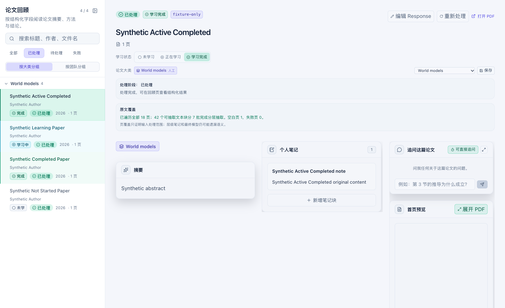

# Full-paper extraction acceptance — 2026-10-31

## Outcome

The Codex CLI paper-extraction path no longer stops at 54,000 local characters or four source batches. It now builds a validated manifest for every PDF page, sends every locally extractable source chunk through bounded map calls, reduces those notes hierarchically, and only then requests the existing structured JSON. Checkpoints are atomic and bound to the source hash, manifest, prompt/instructions, model, reasoning setting, and budgets.

The provider API path remains `file_search`. Its coverage record deliberately says that provider retrieval is unverified; a complete local page audit cannot prove which pages the provider supplied to the model. If its old 32,000-character local fallback is used, the UI discloses that limit.

## Definition of Done

- [x] No prefix or four-batch cap on the Codex CLI source plan.
- [x] Every source chunk carries page, character range, section, and evidence ID.
- [x] A failed page stops before any model call and names the failed page; it is never reported as complete coverage.
- [x] Empty/image-only pages and possible semantic omission are disclosed separately from parser success.
- [x] Map input is bounded to 12,000 characters, reduce input to 24,000, final notes to 32,000, and a paper is refused before calls if it needs more than 96 map batches.
- [x] Map/reduce/final results resume from source-bound atomic checkpoints; partial failures do not repeat completed batches.
- [x] Timeout fallback removes images only; it never drops evidence notes.
- [x] API `file_search` and CLI full-page semantics are explicitly distinct in persisted coverage and the Review UI.
- [x] Reprocessing invalidates stale extraction coverage.
- [x] Maintained backend and real React lifecycle checks cover the new implementation and UI.
- [x] No real paper, database, Wiki, service, or provider was read, changed, started, or called.

## Synthetic evidence

- A real generated 18-page PDF containing more than 54,000 extractable characters produced more than four map calls; a marker present only on page 18 appeared in the last source prompt and the run reported all 18 pages covered.
- An oversized synthetic page was split into multiple located evidence chunks and every manifest chunk appeared exactly once in the source plan.
- A two-page manifest with a parser failure on page 2 made zero model calls and returned `failed pages=2`.
- An interrupted multi-batch run resumed the already checkpointed batches and reused a hash-validated final response.
- The React Review fixture renders `原文覆盖`, page count, source chunk count, and map-batch count from a privacy-safe API summary. The screenshot below contains synthetic data only.

## Validation

- Environment: Python 3.12.13 in this worktree's `backend/.venv`; Node 24.14.1 in this worktree's `frontend/node_modules`.
- Targeted: `backend/.venv/bin/python -m unittest backend.tests.test_paper_extraction_hierarchy backend.tests.test_vlm_service_validation`.
- Unified: `NODE_BIN=/Users/vince/.local/bin/node ./scripts/check.sh` in an approved disposable-loopback environment: 29 startup tests, 236 backend tests, frontend unit/types/build, ESLint with zero warnings, and 8 React UI flows passed. The first sandboxed attempt failed only because that sandbox prohibited loopback socket binding; no application assertion failed there.
- UI evidence is generated by the maintained mock-browser harness with all external requests blocked.

## Limits

- “All extracted chunks were processed” is structural coverage, not a claim that a model retained every semantic detail. The UI says so.
- Locally empty pages can contain figures or scanned text. Selected page images still help the final call, but the system does not call that full visual coverage.
- API `file_search` does not expose page-level retrieval coverage. This change audits the local PDF and reports that limitation; it does not fabricate provider telemetry.
- Real private-library reprocessing and real-provider quality/cost evaluation were intentionally not performed. They require a separate user-approved backup/reprocessing window and provider-data authorization.
