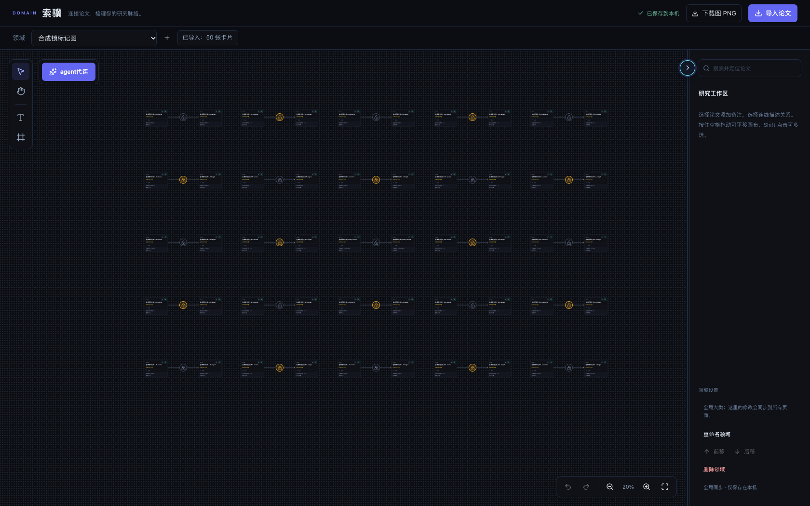
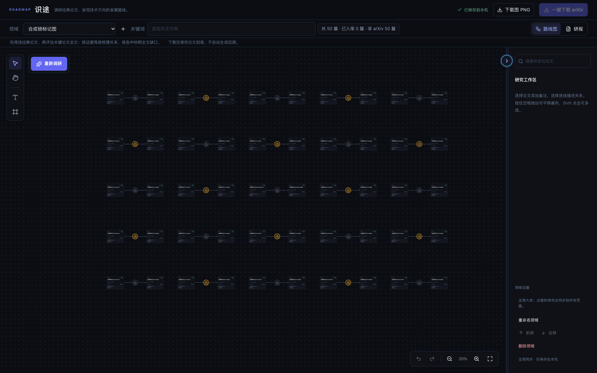
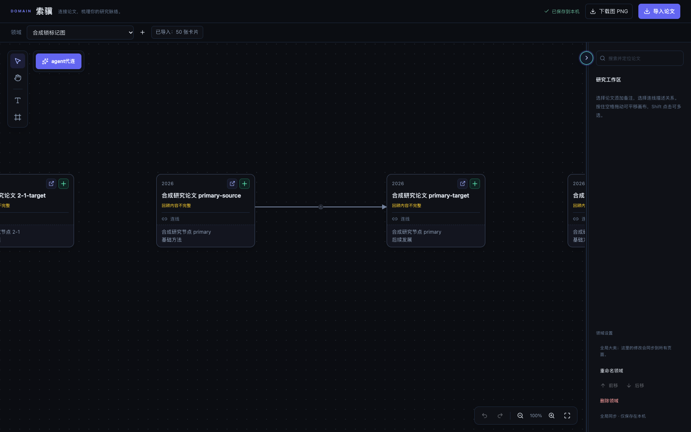
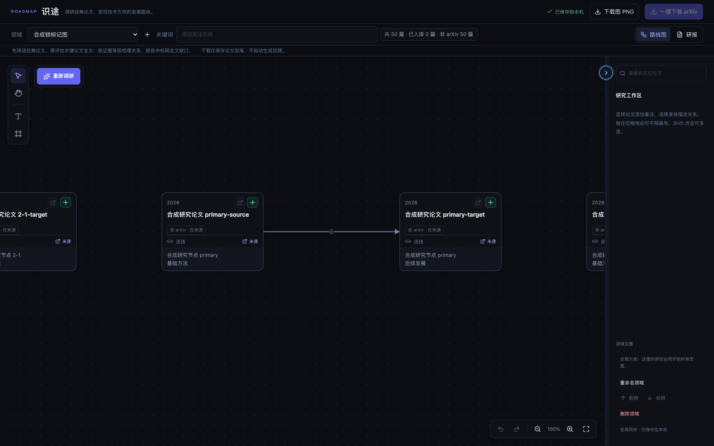

# 索骥／识途连线锁标记：验收证据

验收日期：2026-10-27。两模块共用 `DomainPage` 的连线锁实现。修改使可见标记在低缩放时更小，同时保留 16×16 CSS 像素的点击区域。

- 修改前基线：`8e343347d657ac700281518c667fc7abbf9db595`。
- 修改后已测试提交：`07cb203d61f7d00a56ae8e457a9e8f11be35e9cd`。
- 后续提交只增加本验收资料、更新开发日志和项目交付约定；两个生产文件保持上述已测试版本。
- 本目录新增 8 张 PNG 和本报告，均为此次授权公开的验收材料。业务修改仍仅涉及 `DomainPage.tsx`、`DomainPage.css`；文档另更新 `DEVELOPMENT_LOG.md`、`AGENTS.md`。本机全局约定文件不会进入此仓库。

## 合并前可直接查看的对比

图片来自独立浏览器中真实 React 页面与合成 SQLite 数据，包含 50 篇合成论文、25 条连线。两轮使用相同布局、视口和数据；PNG 为原始截图，尺寸均为 1680×1050，没有裁剪、拼贴或图像生成。20% 图中灰色和金色标记分别显示未锁定与已锁定状态；文件名中的 `unlocked` 指中心 `primary` 连线。

点击图片可查看原始尺寸。先比较 20% 图中的标记与论文卡片比例，再看 100% 图中锁图形是否仍可辨认。

| 模块／缩放 | 修改前 | 修改后 |
| --- | --- | --- |
| 索骥 20% |  |  |
| 识途 20% |  |  |
| 索骥 100% |  |  |
| 识途 100% |  |  |

## Definition of Done 与实测结果

尺寸由浏览器 `getBoundingClientRect()` 测量，下表四舍五入至 0.1 CSS 像素；点击区域另通过可见标记之外的按钮边缘点击验证。

| 视图／画布缩放 | 修改前 圆标记／锁图形 | 修改后 圆标记／锁图形 | 前后点击区域 |
| --- | --- | --- | --- |
| 索骥 15%、20% | 16／9 px | 7.2／4.8 px | 16×16 px |
| 识途 5%、20% | 16／9 px | 7.2／4.8 px | 16×16 px |
| 两模块 100%、200%、250% | 16／9 px | 12／8 px | 16×16 px |

- [x] 两模块共用的连线锁圆标记和内部图形均缩小；低缩放下圆标记直径减少 55%，常规缩放减少 25%。
- [x] 缩小时可见标记不反向放大；放大时尺寸上限为 12 px，点击区域始终为 16×16 px。
- [x] 锁定／解锁、灰色／金色状态、连线选中、悬停和键盘焦点正常；按钮边缘仍能点击。
- [x] Space、Enter、真实双击、真实鼠标三连击及同帧重复点击符合翻转次数；不意外选择／移动节点，不改变视口或边数量，状态可保存。
- [x] 禁用按钮悬停保持外层点击区透明。此项通过临时 DOM `disabled` 验证 CSS，未创建真实调研任务。
- [x] 修改前后各 10 组浏览器场景通过，共 20 组：索骥 15/20/100/200/250%，识途 5/20/100/200/250%。真实三连击和额外同帧点击在修改后场景中补验。
- [x] 统一验收通过，独立代码审查和本次公开图片／文件隐私审查通过。
- [x] 两轮专项的 API shutdown 完成；浏览器正常退出，无遗留进程、监听端口、worker 或 jobs，无页面错误、外部请求或边界违规。

## 环境与验证范围

独立工作区安装环境：Python 3.12.13、Node 24.14.1、Vite 8.0.10、TypeScript 6.0.3；macOS 上已安装的 Chrome，独立临时浏览器环境，视口 1680×1050。

| 检查 | 结果 |
| --- | --- |
| `./start.sh --check` | 通过；仅预检，未启动服务 |
| `./scripts/check.sh` 启动夹具 | 23 项通过 |
| 维护中的隔离后端子集 | 31 项通过 |
| 前端 polling 单测 | 5 项通过 |
| TypeScript、Vite 构建、生命周期类型／构建 | 通过 |
| 完整 ESLint | 0 errors、0 warnings |
| 现有 mock 浏览器生命周期回归 | 5 项通过 |
| 本次锁标记专项 | 修改前后 20 组全部通过 |

专项复用 `scripts/check_research_canvas.py` 与生产 `research-canvas-harness.tsx` 的隔离方式，运行真实研究路由和 React 页面，数据完全为合成 SQLite，未挂载应用 lifespan。专项驱动和完整原始日志保留在本地忽略缓存，本目录仅发布精选截图与汇总，不包含真实数据库、用户截图、个人目录、环境或完整缓存。

初次 npm 下载发生 `ECONNRESET`，按原锁和安装策略重试成功。专项夹具最初使用索骥不允许的纯文本连接、以及超出 250% 上限的 300% 缩放；修正夹具后，修改前后均完整重跑通过。这些失败未引起产品或依赖策略改动。独立审查发现的禁用状态悬停背景已修复并纳入最终验证。

未覆盖真实日常研究数据、外部模型服务或其他浏览器；未运行整站 E2E、PostgreSQL RLS、部署或 CI。本次没有启动入口改动，因此未运行 `--real-start`。本报告记录本地验收结果，不代表 GitHub CI 或人工批准。

## 文件一致性

两份生产文件的 SHA-256 已同时与测试快照和对应 Git 提交核对。最终 PR 的业务代码应继续匹配修改后值。

| 文件 | 修改前 SHA-256 | 修改后 SHA-256 |
| --- | --- | --- |
| `frontend/src/pages/DomainPage.tsx` | `4d52a2c975b2dc04b7bc2d2fcc80f552174e44b29b159a19016e8a082a4f3c5c` | `df5e76ed74286660776053e85898199448b814668a6805aa2fb4f0757d5eda22` |
| `frontend/src/pages/DomainPage.css` | `a834318cc8a3f81bafe08340fb27068da47a157a703594f625f07b27f753db4f` | `d30ecfdafa479480c87113ad40b4197d79c5114b16f170b053560f71d687d426` |

公开 PNG 与原始验收截图逐字节一致，均无文本或 EXIF 元数据：

| 文件 | SHA-256 |
| --- | --- |
| `before-domain-20-unlocked.png` | `c9cbe596f05944c640cc582556edf1ae845cc37e0dcecbcc739a9345ac442685` |
| `after-domain-20-unlocked.png` | `a5b21a64422b0e27551ec6a328740369ad36d3f35cc572699494d8634ac895b7` |
| `before-roadmap-20-unlocked.png` | `7dd4a2da7887b21db5a159bacc1e953367afc6fb911a91cb39a1fee4ccb4d61f` |
| `after-roadmap-20-unlocked.png` | `7ff12f62020f7d4b02bb1e1c6ba3a96235a9360caefe84934fc0fcf5c14924e1` |
| `before-domain-100-unlocked.png` | `d22efc76fb01fe4dbe339378bed5e38f8843296f3fea0c7db4e3b3b3eafce201` |
| `after-domain-100-unlocked.png` | `e18d08fd5a907e07c7bfceaf405611fd8330e0c973f2714e3508d9081159d9a7` |
| `before-roadmap-100-unlocked.png` | `eb7b606a4db49f4ba871aa112183e718c5459a54f3d3cbfec2a6a9b30cefc3bc` |
| `after-roadmap-100-unlocked.png` | `a15bb259c723f1cb34a2f8ddd182c6aa4d42e8f1daa731ad67d468bad3baf7b7` |
