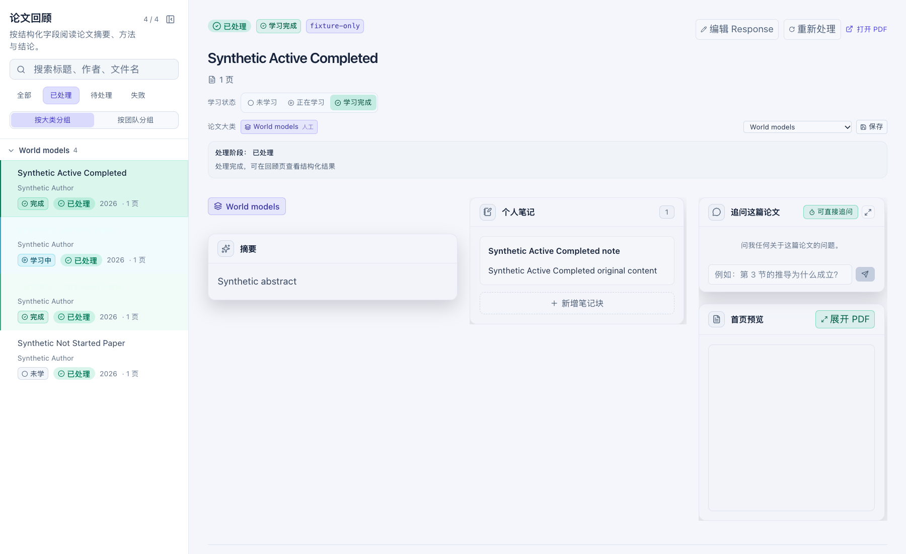
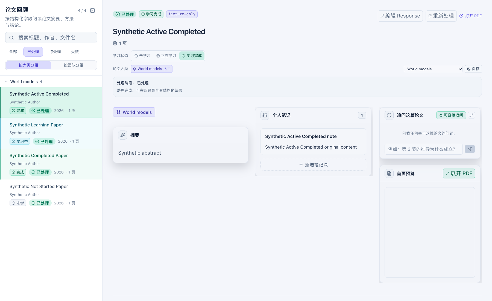

# 白色主题论文标题对比度修复 DOD

交付：[PR #37](https://github.com/vince-xunzhe/Knowra/pull/37)，非 Draft，等待用户合并。本目录只含合成论文与本地 mock API 生成的公开证据；用户参考截图仅在私有临时目录查看，没有复制进仓库。

- 日期：2026-10-29。
- worktree：`/tmp/knowra-light-paper-titles-20261029`（macOS 解析为 `/private/tmp/knowra-light-paper-titles-20261029`）。
- 分支：`codex/fix-light-paper-titles-20261029`。
- freshly fetched 基线：`408953b2df18001ece19fbfc4cc4d07cfcf7ba4c`。
- 完整代码与验证提交：`90e50953d9264138624ce62e9387c8799b073c78`；后续提交仅回填 PR 链接与最终交付元数据。
- 已核实上一轮 [PR #36](https://github.com/vince-xunzhe/Knowra/pull/36) 为非 Draft，并于 2026-10-29 合并为 `408953b`；本轮以该提交为基线。

## 根因与最小修复

论文回顾列表为未选中的“正在学习”和“学习完成”标题分别使用 `text-cyan-50`、`text-emerald-50`。白色主题只重映射了这些语义色系的 `100–400` 色阶，因此 `50` 仍是深色主题的近白色，落在浅青／浅绿列表背景上后只有约 1:1 的对比度。标题数据、分组、状态和 DOM 都存在，问题仅在这一状态配色分支。

生产改动只将两种标题状态接入白色主题已经维护的 `cyan-200`／`emerald-200` 语义色阶。选中标题继续使用 `text-foreground`，未学习标题继续使用 `text-slate-300`；没有改变行背景、状态标签、筛选、排序、分组或论文数据。

## 同一合成页面、同一视窗

两张图均由真实 React `ReviewPage`、4 篇虚构论文、内存 mock API、Chrome 临时 profile 在 **1800×1100、白色主题、125% CSS 缩放**下生成；没有裁剪、拼图、图像生成或外部请求。

| 修复前 | 修复后 |
| --- | --- |
|  |  |

浏览器从真实计算样式读取前景色，并将标题到根节点的半透明背景逐层合成后按 WCAG 相对亮度计算对比度：

| 状态 | 修复前 | 修复后 |
| --- | ---: | ---: |
| 选中／学习完成 | 13.52:1 | 13.52:1 |
| 未选中／正在学习 | **1.01:1** | **6.91:1** |
| 未选中／学习完成 | **1.00:1** | **7.28:1** |
| 未选中／未学习 | 9.42:1 | 9.42:1 |

[修复前原始指标](before-light-125-metrics.json) · [修复后原始指标](after-light-125-metrics.json)。回归门槛为每个标题至少 4.5:1。

## Definition of Done

- [x] 通过受支持的 Library materialize 流程在本机查看用户截图实际像素；未假设云路径可用，未公开截图或真实论文内容。
- [x] 从 freshly fetched `origin/main` 新建 worktree 与分支；原 checkout、旧 worktree、用户编辑及日常研究数据保持不变。
- [x] 依据截图和代码定位状态标题使用未重映射的 `50` 色阶，而不是猜测数据缺失或强制覆盖一处任意颜色。
- [x] 最小修复保留学习状态色义、选中态、未学习态、行背景、徽标、筛选、分类／团队分组和切换交互。
- [x] 合成浏览器回归覆盖白／黑主题、未学习／学习中／学习完成、选中切换、分类／团队分组、80%／125% 缩放；所有标题均可见且对比度不低于 4.5:1。
- [x] 修复前后同场景截图、原始对比度指标、统一检查结果及已知限制可由 PR 直接访问。
- [x] 隔离环境安装、只读启动预检、统一后端／前端／浏览器检查、diff 检查和像素复核通过；没有启动真实应用或访问真实数据。

## 实际验证

| 检查 | 结果 |
| --- | --- |
| `scripts/install-native.sh` | 通过；本 worktree 独立 Python 3.12.13／Node 24.14.1 环境，哈希 Python lock 与官方 npm lock，生命周期脚本禁用 |
| `BACKEND_PORT=8137 FRONTEND_PORT=5217 ./start.sh --check` | 通过；仅预检，没有启动服务 |
| `scripts/check.sh` | 29 项启动夹具、58 项隔离后端、33 项前端单测全部通过 |
| TypeScript／Vite／完整 ESLint | 通过；ESLint 0 error／0 warning |
| 生命周期浏览器 | 6 项通过、0 外网／未 mock 请求违规；新增标题对比度场景通过 |
| 修复前门槛 | 新增回归按预期失败：学习中 1.01:1（随后以同一夹具验证修复） |
| `git diff --check` 与两张证据图像素复核 | 通过；无空白错误，标题、布局和缩放一致 |

[机器可读验证摘要](verification.json)。首次统一检查的 29 项启动和 58 项后端已通过，但前端快照因本轮手工基线捕获留下的 `frontend/tmp` 同名生成目录而在执行测试前停止；删除仅由本轮生成的 `lifecycle-dist`、`lifecycle-results.json`、`tmp` 后，从头重跑统一检查并全部通过。

环境：macOS，Python 3.12.13，Node 24.14.1，Vite 8.0.10，TypeScript 6.0.3，Chrome `/Applications/Google Chrome.app/Contents/MacOS/Google Chrome`。依赖、缓存、测试数据与浏览器 profile 均位于本 worktree 或其 `.cache` 隔离目录；浏览器只监听随机回环端口，所有业务 API 均为合成 mock。

## 数据边界与限制

没有读取、打开、复制、迁移、同步或修改真实数据库、论文、配置、账户、订阅或用户服务；没有刷新用户页面、停止用户进程、运行真实 provider／LLM／市场调用或执行排队任务。截图物化与查看只发生在私有 `/tmp` 目录，未进入 Git。

未验证真实研究数据、跨浏览器、完整应用 E2E、PostgreSQL RLS、移动端、CI 或部署。本轮没有原生启动改动，因此未运行 `scripts/check.sh --real-start`。PR 由用户 merge；本轮不 merge、不部署。
