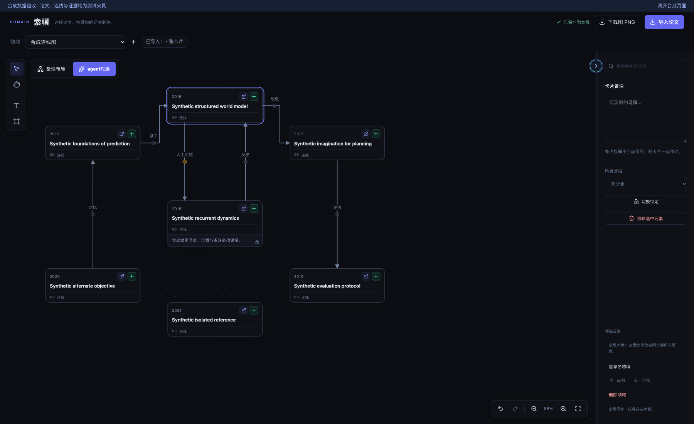
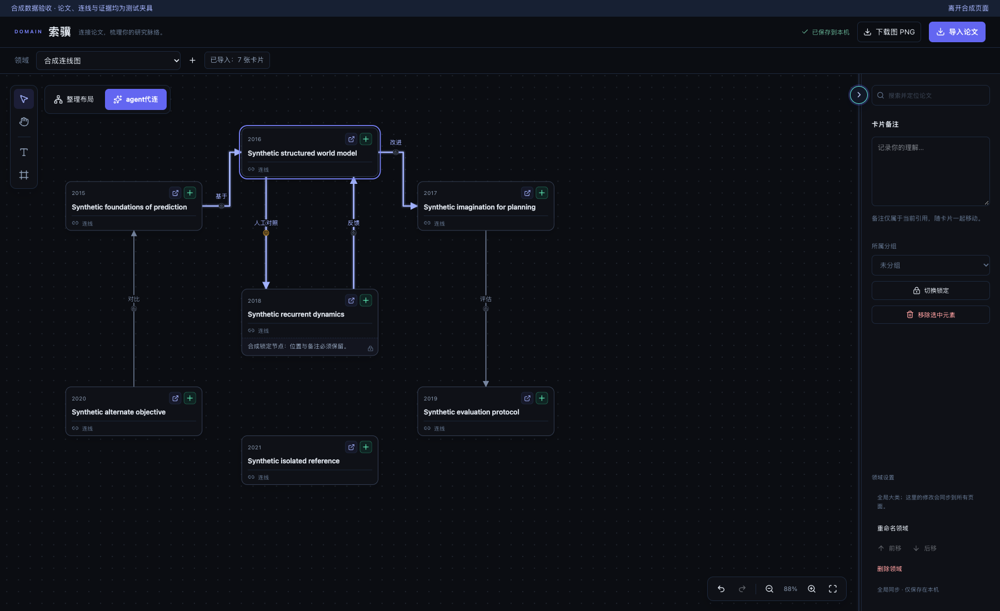
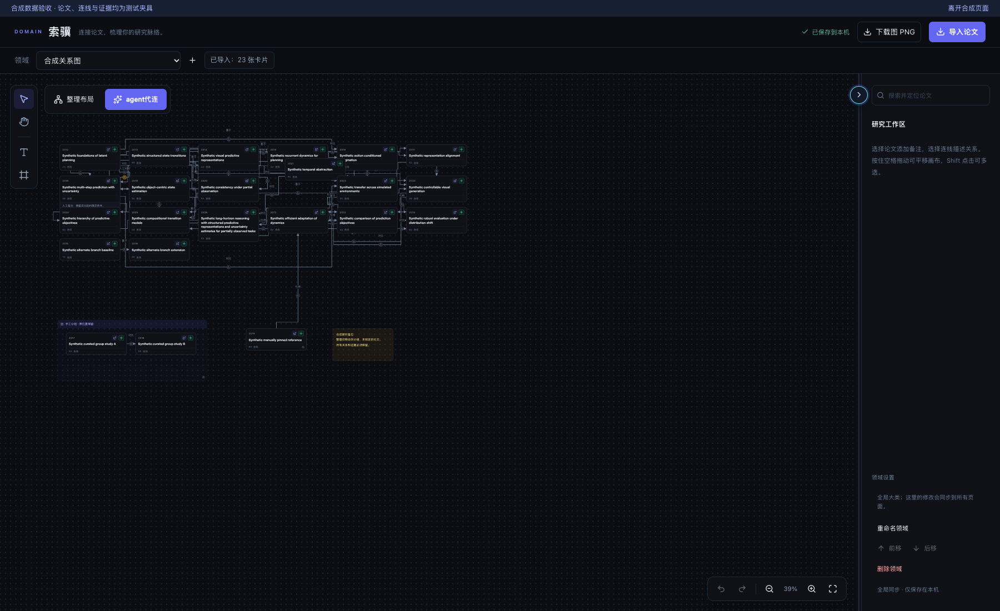
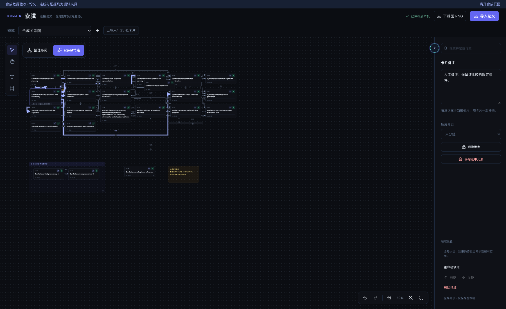

# 索骥论文关联连线高亮验收

点击论文后，直接入边和出边以柔和脉冲提示两次（总计 2.8 秒），随后保持高亮。点击另一篇切换，点击空白或 Escape 取消；减少动画偏好下立即静态高亮。Enter 可选择论文并高亮，Space 保留原有画布平移。

基线为已合并 [PR #34](https://github.com/vince-xunzhe/Knowra/pull/34) 的 `1291cc472a42f1399db28526031cbc89ccc14117`（2026-10-28）。受测功能提交为 [`0a81b466dd29cf52619f71160d513dfc3a8f72c3`](https://github.com/vince-xunzhe/Knowra/commit/0a81b466dd29cf52619f71160d513dfc3a8f72c3)。检查在提交前的工作树执行，统一／布局／高亮快照中的 117 项前端源码与测试文件均与此提交相同，云冻结的 87 项运行源码、策略和专用 harness 相同。原报告的 `source_head` 为基线，不冒充功能提交；见 [验证和提交对应](verification.json) 与 [SHA-256 清单](source-manifest.json)。后续交付提交仅包含本目录和开发记录。

## Definition of Done

- [x] 所有直接入／出边及双向关系完整高亮；重复点击与切换、无边节点、空白取消通过。
- [x] 动画实际改变线宽和透明度，2.8 秒后无运行中的动画；减少动画时从首次渲染即无动画。
- [x] 高亮仅为临时 UI 状态；点击、取消和 1–4px 微抖没有保存请求，数据、节点位置及路径逐项一致。
- [x] 双击、多选、拖动、拖出再返回、缩放、Space 平移、Enter／Escape、卡片内部按钮、连线模式及边锁／证据保留。
- [x] 领域／页面切换和刷新清理；只读 Agent 状态与整理布局预览可查看关联；布局比较、取消、应用和撤销通过。
- [x] 识途不启用此功能；云冻结 8 组回归、31 个直接入口以及 9 组合成 storage 状态保留。
- [x] 独立代码和截图审查完成；审查发现的微抖保存与 Space 平移问题已修复并回归。
- [x] 仅使用隔离合成数据；参考原图没有进入仓库或证据，没有访问日常数据库、论文、配置、现有服务或云账户。

## 前后与动画阶段证据

全部图片为真实 React 组件的 1800×1100 浏览器截图；标题、关系、备注与证据均为合成夹具。没有重绘或处理截图。

| 场景 | 证据 |
| --- | --- |
| 新 main 基线：同一篇论文选中，关联线保持原色 |  |
| 新功能：脉冲结束后关联线保持高亮 |  |
| 动画中间阶段：约 667ms，线宽约 3.995px、透明度约 0.652 | [脉冲截图](after-pulse.png) |
| 动画结束：线宽 2.8px、透明度 1，无活动动画 | [静态截图](after-static.png) |
| 减少动画：无动画，立即静态显示 | [减少动画截图](after-reduced-motion.png) |
| 23 篇论文／42 条关系，39% 缩放点击前 |  |
| 同图点击后：节点与原路径不变，所有直接连接线可见 |  |
| 放大到 61% 继续保留高亮 | [放大后](dense-after-61-percent.png) |
| 证据、锁定、拖动与布局预览 | [边证据](after-evidence.png) · [缩放拖动锁定](after-zoom-drag-lock.png) · [布局预览](after-layout-preview.png) |

[浏览器原始结果](browser-results.json) 包含 `started`、`midPulse`、`settled`、`reducedMotion` 四阶段的浏览器动画状态、实际计算样式和请求记录。前两个阶段均检测到两次 1400ms 动画，结束后和减少动画模式均为零；不以单张截图声称证明动画。

## 实际检查

| 检查 | 结果与记录 |
| --- | --- |
| `./scripts/check.sh` | 29 项启动夹具、58 项隔离后端、22 项前端单测、类型／Vite 构建、完整 ESLint 0 errors／0 warnings、5 项生命周期浏览器流程通过。[原始输出](unified-check.txt) · [22 项单测输出](unit-check.txt) |
| `scripts/check_domain_highlight.py` | 10 组全部通过，零页面／网络违规，浏览器与随机回环静态服务正常清理。[结果](browser-results.json) |
| `scripts/check_domain_highlight.py --baseline 1291cc4…` | 同一夹具对照通过。[结果](baseline-results.json) |
| `scripts/check_domain_layout.py` | 8 组全部通过，零违规，正常清理。[结果](layout-results.json) |
| `scripts/check_cloud_freeze.py` | 8 组全部通过，外部请求零尝试／零违规，合成 storage 无改写，正常清理。[结果](cloud-results.json) |
| 独立审查 | 代码、测试隔离与真实鼠标命中检查通过；实际查看静态／脉冲／39% 密集图截图，无剩余阻断项。 |

环境：macOS 26.5.1；Python 3.12.13；Node 24.14.1；Vite 8.0.10；TypeScript 6.0.3；Chrome 156.0.8078.48。独立环境位于 `<worktree>/backend/.venv`、`<worktree>/frontend/node_modules`，Node 位于本 worktree `.cache/runtime/`。只读预检使用 API 8129／Web 5209，预检没有启动服务；实际浏览器使用私有 profile 和随机回环端口，全部 API mock，外网阻断。官方锁文件及依赖不变。

测试阶段曾因 sandbox 禁止回环监听而失败，按正常审批重新执行后通过；没有绕过自动拒绝。安装过程中未改动全局环境或旧工作区。第一次独立审查发现的点击微抖保存和卡片获焦后 Space 平移回归均在最终检查前修复，不将早期结果当作最终验收。

## 范围与限制

生产修改只有索骥页面、样式和三份翻译。保留原边路径、锁定点击区、关系／证据、保存和历史语义；高亮叠层不接收指针事件。显式拖动、缩放、锁定、连线或应用布局仍按既有行为保存，不归为高亮写入。

未验证真实研究数据、真实模型／外部服务、完整应用 E2E、PostgreSQL RLS、其他浏览器、移动端或部署。没有改启动入口，因此未运行 `--real-start`；普通检查中的启动夹具照常执行。以上为本地验收，GitHub checks 在 PR 中另行核验，不将无 checks 说成 CI 通过。没有 merge、部署或更改订阅，用户负责合并。
