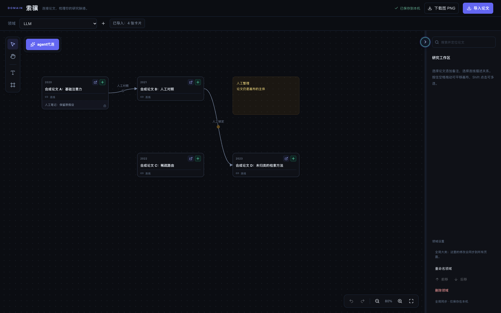
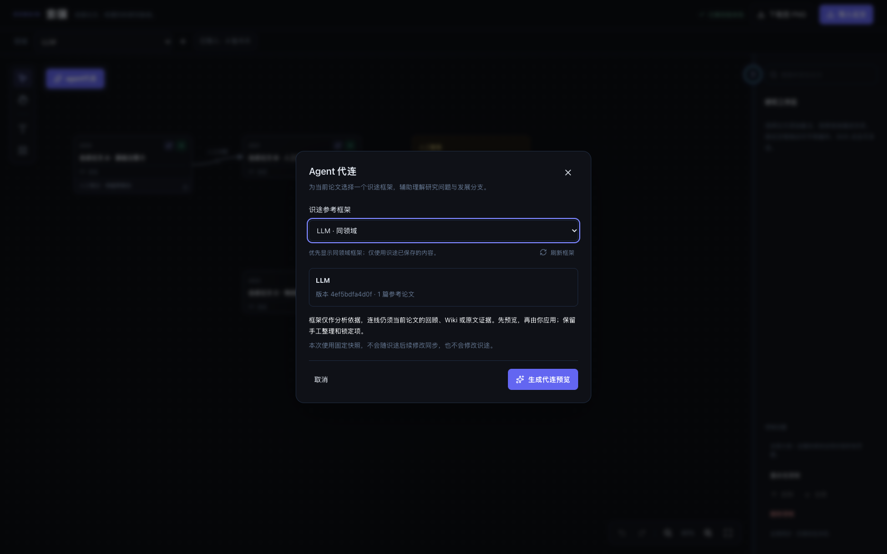
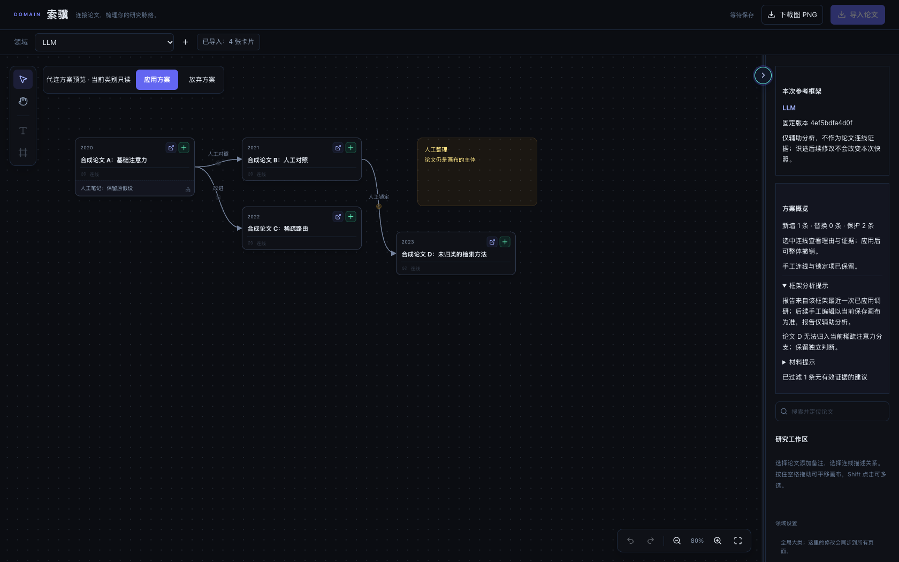
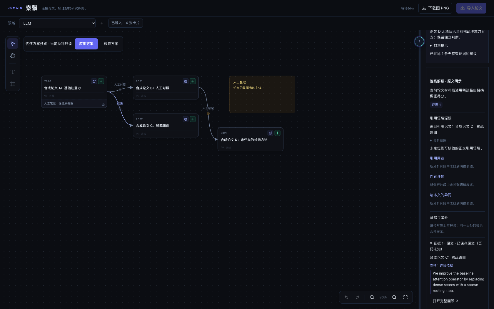
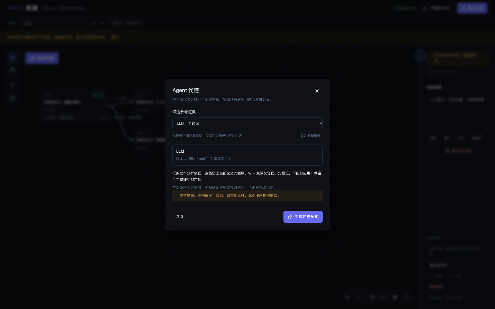

# 索骥 Agent 参考识途框架：验收证据

验收日期：2026-10-27。索骥继续以当前画布的论文为主体；点击 Agent 代连，可选择一个已保存的识途框架辅助分析，也可明确选择“不使用框架”。生成结果先预览，由用户应用或放弃。

- 基线：`803461809867c9d78133839b1ac477e1b396b52c`，已核实 [PR #31](https://github.com/vince-xunzhe/Knowra/pull/31) 合并。
- 受测代码提交：`a3f58c9ccc9b0c1d6fbc81d492124c002278f9eb`。提交与最终专项源码快照逐文件校验一致；后续仅增加本报告、原始截图和开发日志的证据链接。
- 本报告是本地隔离验收记录，不代表 GitHub CI 或人工批准；用户负责最终 review 和 merge。

## 可直接查看的前后界面

以下都是 1680×1050 原始浏览器截图，使用 4 篇合成论文、2 条人工连线及合成框架。没有真实研究数据，没有图像生成、裁剪或拼贴。修改前截图采用基线前端源码与同一合成画布，只展示入口与论文布局；它不声称验证了旧版 Agent 的生成结果。

| 场景 | 原始截图 |
| --- | --- |
| 修改前：论文画布和原代连入口 |  |
| 修改后：可选同领域框架，显示固定版本及论文证据要求 |  |
| 修改后：论文仍为主体，先预览；保留人工／锁定边，显示不匹配说明 |  |
| 论文连线证据：当前论文、保存原文出处和连续引文 |  |
| 框架删除后的恢复提示 |  |

## Definition of Done

- [x] 可选识途参考框架，同领域优先；空列表或读取失败仍可明确采用论文材料生成。
- [x] 服务端读取当前本地工作区并校验目标类别、框架、来源与完整语义版本；新列表接口不协调分类、不修改识途画布或任务状态。
- [x] 保存固定快照和 SHA-256 版本，包含现有研究问题、分支、里程碑、阶段、关系及来源；只使用最近已应用的报告，记录其运行 ID／日期并提示它可能早于手工画布修改。
- [x] 选择后框架发生变化时拒绝启动并提供重新选择路径；任务开始后框架修改或删除不改变快照。
- [x] 框架与论文文本都按资料处理；框架不进入论文证据允许集合，不能用同分支或框架演进线直接证明论文关系。
- [x] 上下文按容量截断并提示；保留完整来源标识及报告段落引用，来源无法放入预算时省略对应内容。
- [x] 预览不写入索骥画布，应用才提交；手工边、人工修改过标签的生成边、锁定边／节点与笔记保留。
- [x] 重复点击、取消、中断、切换领域、延迟框架读取、过期预览、空论文画布等边界通过。
- [x] 无框架时维持原论文模型提示与输入结构；索骥请求不再误带识途专属 `relationPolicy` 字段，避免严格请求校验的 422。
- [x] 统一检查、12 项专项后端单测、3 项前端请求契约单测、15 组专项浏览器流程及独立审查通过。
- [x] 测试服务正常退出，无遗留进程、端口、worker、真实模型调用或网络边界违规。

## 实际验证结果

| 检查 | 结果 |
| --- | --- |
| `./start.sh --check`，独立 API 8137／Web 5217 | 通过，仅预检，无服务启动 |
| `./scripts/check.sh` 启动夹具 | 23 项通过 |
| 统一入口维护中的隔离后端子集 | 31 项通过 |
| 前端 polling 单测 | 5 项通过 |
| TypeScript／Vite 生产构建、生命周期类型与构建 | 通过 |
| 完整 ESLint | 0 errors／0 warnings |
| 现有生命周期浏览器回归 | 5 项通过，零边界违规 |
| `tests.test_domain_framework`，复用隔离后端源码快照与守卫 | 12 项通过；含真实路由、合成数据库及可控模型调用 |
| `frontend/tests/domain-framework.test.mjs`，在隔离前端快照运行 | 3 项通过，零跳过 |
| `scripts/check_domain_framework.py --baseline` | 原始前端截图通过，正常退出 |
| `scripts/check_domain_framework.py` | 最终 15 组流程通过，9 次可控模型调用 |
| 两轮独立实现／边界审查与公开材料检查 | 发现的问题已修复，无未解决实现问题 |
| 完整 diff、源码／截图哈希与最新主线冲突检查 | 通过 |

统一检查完成后，最后一项报告引用保留修正再次通过全部 12 项专项后端检查和完整 15 组真实路由／浏览器流程；前端文件与已通过的类型、构建、lint 和单测快照一致。

专项浏览器的 15 组验收：

1. 默认不使用框架、同领域优先、空框架不列出；列表读取前后识途 revision、画布和运行状态完全一致。
2. 同帧连续点击三次只创建一次运行；服务端也拒绝重复待处理运行；快照含研究问题、分支、阶段与来源，排除未应用报告。
3. 开始后修改／删除框架，真实生成函数仍接收原快照；框架伪证据被过滤，当前论文连续引文保留；人工边、锁定边／节点和笔记不丢失。
4. 生成过程中切换领域，新画布不显示或应用旧预览；返回原领域后显示正确运行。
5. 显式应用只提交一次，新增一条有论文证据的建议边并保留两条人工边；识途无写入。
6. 不使用框架时模型输入只有原论文资料；人工编辑过标签的生成边在下一次生成中保留。
7. 重复取消释放只读状态；延迟执行检查取消，不调用模型或恢复旧预览。
8. 模拟任务中断后，真实轮询路由反映失败并解除只读，允许重新生成。
9. 选择到提交之间框架改变，返回可恢复冲突；刷新清空旧选择，要求明确重新选择。
10. 选择后框架变空或删除，分别返回可操作提示，不悄悄回退。
11. 框架列表 503 时明确不使用框架仍可生成（控制列表失败响应）。
12. 空框架列表说明论文材料回退且操作可用（控制空列表响应；后端无工作区场景另由单测覆盖）。
13. 框架读取延迟时关闭选择器并切换领域，迟到响应不会重新打开界面或创建运行。
14. 外部画布修改使应用返回 409，保留外部修改，允许安全放弃。
15. 空论文画布禁止开始代连。

## 架构与环境边界

两个模块复用 `DomainPage`，但继续使用独立的画布、API 和任务。新增只读 `/api/domains/agent/frameworks` 从本地 `DomainWorkspace`／`RoadmapWorkspace` 取候选；启动请求带框架 ID 与完整语义哈希，服务端重新核验并把有界内容保存在既有 `DomainAgentRun.snapshot`，不引入版本表或数据库迁移。

当前真实权限模型是本地数据库单实例，这两个工作区没有用户列，云模式不挂载对应路由；新框架路径额外拒绝云模式。没有把独立识途文献 ID 当作本地论文 ID，也没有新增分支骨架、同步框架或搬运论文功能。

环境：macOS、Python 3.12.13、本工作树独立 `backend/.venv`、Node 24.14.1、Vite 8.0.10、TypeScript 6.0.3、已安装的 Chrome，临时 profile、1680×1050。Python 与 npm 按仓库哈希锁安装，wheel-only／禁用 npm 生命周期脚本；未升级依赖。

专项使用真实研究路由、真实生成函数和真实 React；合成 SQLite 与源码位于本工作树忽略缓存，随机回环 API／Web 端口，屏蔽外部网络，不挂载主应用 lifespan。任务提交与模型网关 callable 由夹具控制，不启动独立任务 worker。最终记录：API shutdown 完成、零残留 PID／端口、零页面异常、零网络边界违规、零 worker。没有导航、刷新或关闭日常用户页面。

## 修复记录与限制

初次隔离安装因沙箱 DNS 失败，获准执行后 npm 又遇到一次 `ECONNRESET`，按相同锁和官方源重试成功；未更改包管理策略。未提升权限的启动夹具首次无法绑定回环端口，之后以获准的隔离检查完整通过。专项夹具初次配置 stub 缺少关键字参数，后端取消单测初次没有模拟执行器的队列终态，均修正测试夹具后完整重跑。未跳过失败、扩大超时或降低规则。

审查修复包括：人工改过标签的生成边归为手工连线；来源 URL／DOI 不截坏；省略第三条及后续框架证据时标注截断；长报告截断时保留段尾完整引用。无关业务、启动入口、全局配置与日常数据未修改。

可控模型验证了上下文传递、流程与来源／连续引文校验，**不等于真实 LLM 推理质量验证**；关系的语义判断仍需要用户审阅。未调用外部／付费模型，未读取真实研究内容，未验证跨浏览器、真实用户数据、完整应用 E2E、PostgreSQL RLS、移动端、CI 或部署。未运行既有完整 pytest 套件；本轮新增 unittest 专项使用当前受管依赖执行。本轮没有启动入口修改，未运行 `--real-start`；专项挂载真实路由不代表完整生产启动流程。截断内容不会被当成不存在。

## 文件一致性

| 生产文件 | SHA-256 |
| --- | --- |
| `backend/routers/domain_agent.py` | `61e7592fce4f7d0bb487035850a38c7364589a8b0d8f59ef7ef92de145955fa0` |
| `backend/services/domain_agent.py` | `dd76eac3befc35ae91ec6bace0de0a63df686af256a295de3c4fd0c06d4de2de` |
| `backend/services/domain_agent_state.py` | `de33f19b251262dd4c4ebc05793a99307435aae96c6ecb94542eabcc9bd8dc94` |
| `backend/services/domain_framework.py` | `69566e717c0280b24491e4a0e14c01ca842487703155de8eab71fcb2a8432a20` |
| `frontend/src/api/domains.ts` | `10a49bf1c9ac052caaf13cb5e7f02303945c4f3a81a40b0a66355da91aca2d0c` |
| `frontend/src/pages/DomainPage.tsx` | `b2d15ee5a04220900bf40daa69c8882d497b2ed079b7a0a86afdf08d8f1d7305` |
| `frontend/src/pages/DomainPage.css` | `f44743f5c52c747838d9859d85529455a7827a19af2df729c9e1f2ed0096874f` |
| `frontend/src/pages/DomainFrameworkDialog.tsx` | `6d1cdb16a422e9fea8f13bfc4d4cfcd0989ad1586f92466a5ca7dc818f07ccc8` |

公开截图与原始验收截图逐字节相同，PNG 不含文本或 EXIF 元数据：

| 图片 | SHA-256 |
| --- | --- |
| `after-framework-preview.png` | `c33ab3ec50fc5f37b0f625f396b5ab40429066b07cdf582545365c0ed06b5262` |
| `after-framework-recovery.png` | `921bbeafd55f0b12e5395d9cce2f92ba4ab17300322523224e0bb6c7c38ead01` |
| `after-framework-selector.png` | `92dee13ce6e4b3646483a666107c1328e9e4da815dfc640ddcb0f56d16a51e70` |
| `after-paper-evidence.png` | `5713b4e3b9b3345449bfdeca9bc7bbdcbfb79c9c3715d3ddbd6ccbe5e16b29c8` |
| `before-agent-canvas.png` | `e49add9425749c10c18cb87b2cb3679d19f7223b7b67a8c84b825d9633f9a43d` |
