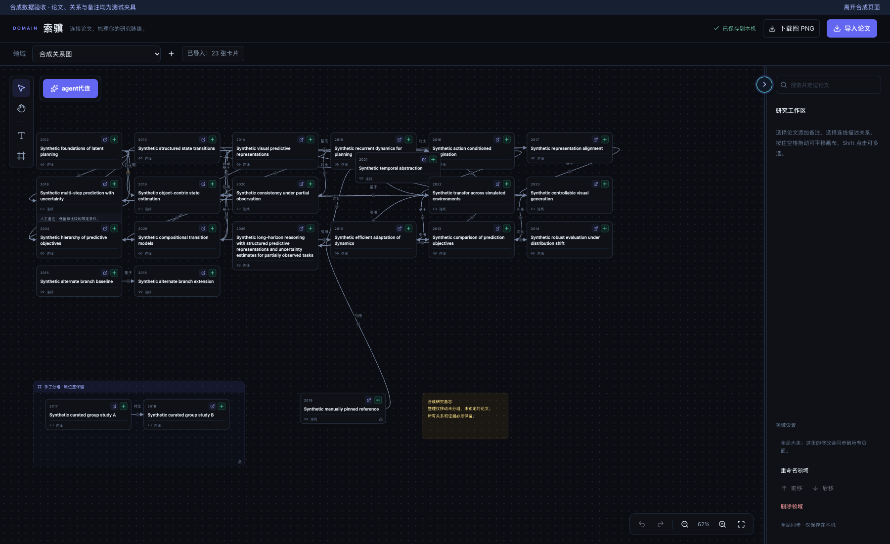
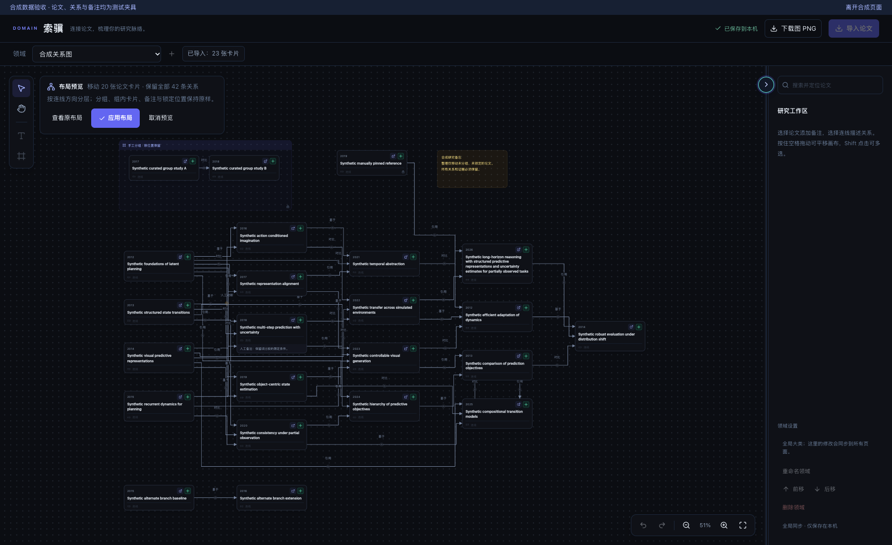
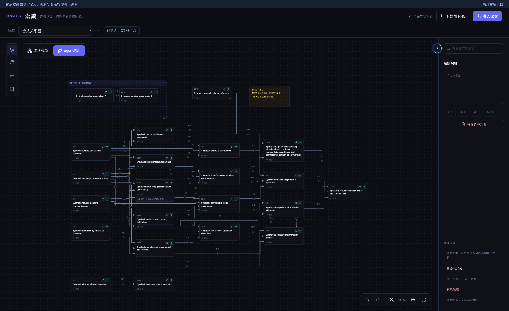
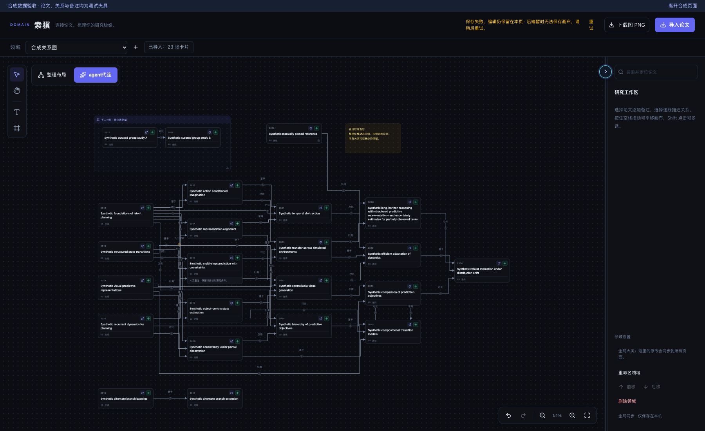

# 索骥整理布局：验收证据

验收日期：2026-10-28。索骥新增“整理布局”：在本地预览分层排布，可对照原布局、取消或应用；应用后可撤销。论文、关系、证据、锁定、分组与备注保持原样。

- 基线：`1b61ecf66634642ee8ad4f800c10313fee74e0c3`，已核实 [PR #32](https://github.com/vince-xunzhe/Knowra/pull/32) 于 2026-10-27 合并。
- **受测代码提交：`3937e875eafc36e99e23ced589bbc12b5e0068af`**。统一检查和专项浏览器检查均在此提交运行；后续仅补公开证据与开发日志。源码／图片 SHA-256、环境和验收汇总见 [verification.json](verification.json)。
- 本报告是本地隔离验收记录，不代表 GitHub CI 或人工批准；由用户 review 和 merge。

## 实际前后界面

以下是相同 23 篇虚构论文、42 条虚构关系的 **1800×1100 原始浏览器截图**，含环、独立分量、长标题、手工边、锁定节点／边、固定分组与备注。没有用户研究内容，没有裁剪、拼贴或图像生成。基线使用上述主线源码；修改后使用受测代码。原视口为 62%，整理预览自动适应为 51%；固定节点的世界坐标没有改变。

| 场景 | 可直接查看的截图 |
| --- | --- |
| 修改前：密集卡片与原始曲线 |  |
| 修改后：本地预览、原布局对照、应用／取消 |  |
| 修改后：应用后的分层与独立分量 |  |
| 原手工锁定关系仍可选择、查看 |  |
| 保存失败时保留画布并提供重试 |  |

真实 DOM／SVG 测量，详见 [基线记录](baseline-results.json) 和 [最终浏览器记录](browser-results.json)：

| 指标 | 基线 | 整理后 |
| --- | ---: | ---: |
| 论文卡片 | 23 | 23 |
| 关系 | 42 | 42 |
| 非分组卡片／文本矩形重叠对 | 4 | 0 |
| 连线穿过非端点卡片的相交对 | 48 | 0 |

穿卡指标每条 SVG 路径采样 220 个位置，按“连线—非端点卡片”对计数，不是关系条数；纯函数单测另验证正交线段与矩形的相交。以上不意味着所有边之间的交叉或标签重叠都已消除。

## Definition of Done

- [x] 实际查看用户参考图，以密集长边穿卡、路径和卡片重叠为问题依据；参考图只作内部分析，未发布。
- [x] 从 freshly fetched origin/main 创建独立 worktree／分支，保留原 checkout 和其他任务。
- [x] 提供本地整理预览、原图对照、应用／取消与一次撤销；不依赖 Agent／LLM 重新分析。
- [x] 采用 SCC 环处理、方向分层、重心排序、分量排列和实测卡片尺寸；稳定重复执行。
- [x] 仅调整未锁定且未分组论文的 x/y 及查看视口；论文内容、节点顺序、所有关系、证据、锁定、分组和备注完全保留。
- [x] 预览及预览内平移缩放不入保存队列；取消、Escape、切换领域／页面、外部刷新均不会应用旧预览。
- [x] 未保存备注在取消、切换领域返回、应用、撤销和保存失败后保留；503 可重试，409 不自动覆盖或重新加载。
- [x] 手工锁定关系仍可选择，关系标签和锁定状态不变；Agent 处理中的画布禁止整理。
- [x] 统一验收、17 项布局／几何单测、8 组专项浏览器流程、真实基线对照通过；独立源码及像素审查通过。
- [x] 合成截图与公开文件经过范围／隐私检查；无真实数据库、论文、凭据、环境或用户参考图。
- [x] 测试临时浏览器与静态服务正常关闭，无外网边界违规；未操作用户已有服务。

## 检查结果与环境

| 检查 | 结果 |
| --- | --- |
| `start.sh --check`，API 8117／Web 5197 | 通过，仅预检，没有启动服务 |
| `scripts/check.sh`：启动夹具 | 23 项通过 |
| 维护中的隔离后端子集 | 31 项通过 |
| 前端单测 | 22 项通过：polling 5＋layout 9＋geometry 8 |
| TypeScript／Vite 生产构建 | 通过 |
| 完整 ESLint | 0 errors／0 warnings |
| 既有生命周期类型／构建／浏览器回归 | 5 项通过，零网络违规 |
| `scripts/check_domain_layout.py --baseline 1b61ecf…` | 基线构建、截图与几何记录通过 |
| `scripts/check_domain_layout.py` | 8 组通过，零页面异常／网络违规，正常清理 |
| 独立源码、边界、像素审查 | 已发现问题均修复，无未解决阻断项 |
| 完整 diff、源文件与截图哈希检查 | 通过，前端源码与最终两套验收快照逐字节一致 |

环境：macOS 26.5.1，Python 3.12.13，Node 24.14.1，Vite 8.0.10，TypeScript 6.0.3，Chrome 156.0.8078.48。worktree 为 `/tmp/knowra-suoji-layout-20261028`（解析为 `/private/tmp/knowra-suoji-layout-20261028`），分支 `codex/suoji-layout-20261028`；独立 `backend/.venv`、`frontend/node_modules` 和 `.cache`。安装使用仓库哈希锁、wheel-only 和禁用 npm 生命周期脚本，未升级依赖。Git worktree 已注册；应用附件接口不支持本任务类型。

专项 8 组流程：

1. 预览、对照、缩放、平移、取消及搜索框聚焦时 Escape 不写入原画布，原视口恢复。
2. 应用完整保留语义和固定节点；连续点击只保存一次；一次撤销／重做恢复；再次整理不移动；刷新仍保持结果；手工锁定边可查看。
3. 保存失败的备注跨领域返回仍保留；预览取消和布局撤销不丢备注；已有失败保存不静默重试。
4. 布局保存 503 保留本地结果和原远端状态，显式重试成功。
5. 布局保存 409 不覆盖远端、不自动重试／加载，本地仍可撤销。
6. 切换领域或离开页面丢弃预览，不写入预览坐标。
7. 外部画布更新使预览失效，保留更新后的备注与位置，不覆盖新版本。
8. Agent 待处理状态保留只读所有权，不产生布局修改。

## 数据隔离与范围

没有读取、打开、迁移、同步或修改日常数据库、论文、配置或其他任务的数据；没有刷新真实用户页面或调用可能回写的真实业务 API。原 checkout 保持干净。所有代码改动在本 worktree 内；此前参考图片通过受支持 Library 流程读取后仅用于内部像素分析。

统一检查遵循仓库既有的隔离源码／合成数据守卫。布局专项不启动后端、数据库或 worker：只复制前端源码，排除 `.env*`／`.npmrc`，Vite 禁止加载环境文件；静态服务使用随机回环端口，临时 Chrome profile／HOME 留在本 worktree 缓存；所有 API 请求由测试内存响应，非静态源／非 mock 请求被阻断。测试过程中没有上传操作。原始浏览器报告确认正常清理，最终静态端口 51303、基线端口 50521 均已关闭。

索骥与识途仍共用页面外壳，但新布局和新连线几何仅在索骥生效；没有修改识途 API、任务或排布逻辑。未修改云鉴权／同步文件，也未纳入未合并的 [云冻结 PR #33](https://github.com/vince-xunzhe/Knowra/pull/33)。该 PR 与本轮共享开发日志、语言文件和前端检查入口；新文字放在既有布局区，减少尾部追加冲突。合并时需保留两轮日志与两组检查。

## 修复记录、文件与限制

初次统一检查发现新增测试页未导出组件的 react-refresh lint 错误，修复后完整检查通过。专项初次因沙箱回环监听失败，升级请求又被误判为只读任务而拒绝；在收到带明确来源的新开发授权证据、复核隔离边界后，对原操作一次重审获准，没有改路线绕过。初次实际浏览器运行发现夹具发出 pointerdown 却没有 pointerup，导致测试自己拖动卡片；改成真实点击后全部流程通过。没有跳过失败、放宽规则或增加超时。

审查还修复：输入框内 Escape 不能取消、失效预览清理延迟、只看第一条边而漏报后续简化路径、密集图重路由成本。几何计算在 23 节点／92 边约 5ms、100／400 约 31ms；这是合成纯函数测量，不是完整浏览器性能保证。

生产文件：`domainLayout.ts`、`domainGeometry.ts`、`useDomainLayoutPreview.ts`、`DomainPage.tsx`／`.css` 和三种语言文字。测试文件：两项纯函数单测、合成数据／React harness／浏览器 runner 和 `check_domain_layout.py`；`package.json` 与标准 `check_frontend.py` 只补两项单测入口。完整生产与测试文件哈希见 verification.json。

限制：分组及全部组内卡片、独立备注、锁定节点保持原位，分组内部不重排；涉及固定节点的边不参与可移动节点分层，但不丢边。固定元素原有重叠仅报告。超过 200 个非分组节点或 800 条关系、或复杂路径搜索预算耗尽时显示简化路径提示，部分边可能穿卡。标签／锁避碰是尽力处理，低缩放下仍可能重叠，密集平行关系需要缩放和选择查看。

未验证真实研究数据、真实模型、跨浏览器、完整应用 E2E、PostgreSQL RLS、移动端、CI 或部署。没有启动入口改动，未运行 `--real-start`；未 merge、未部署。
