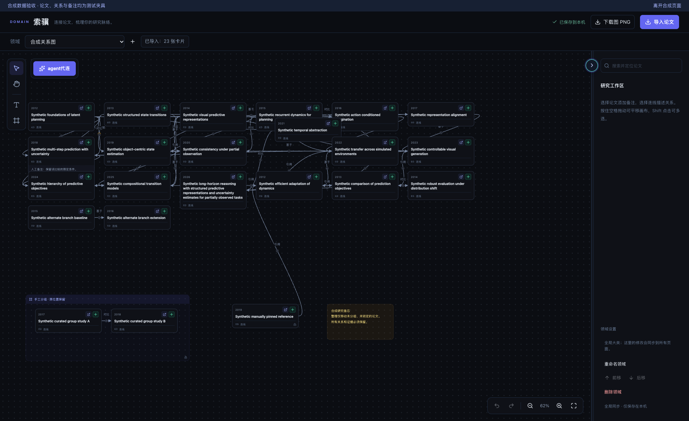
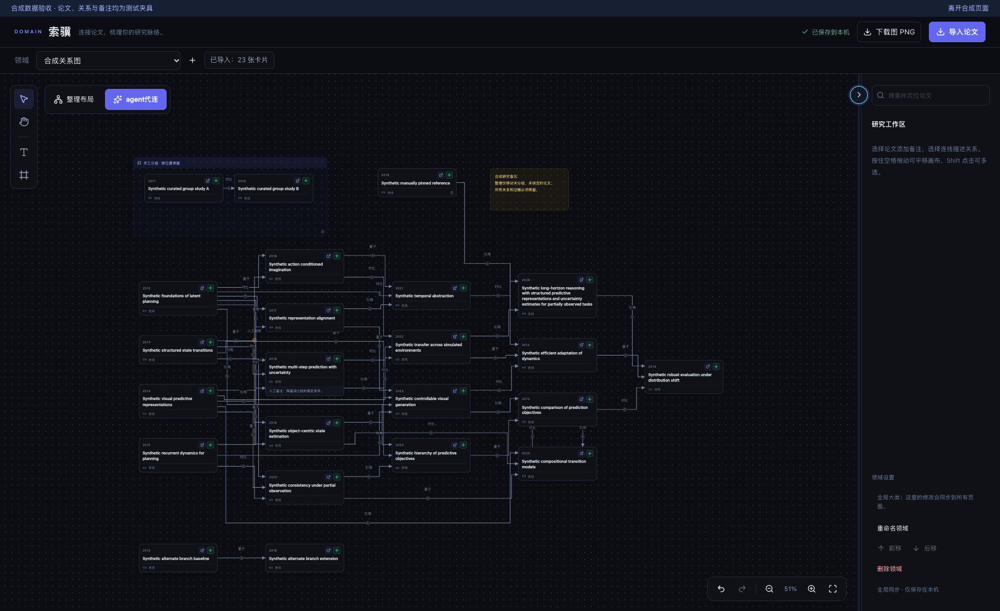
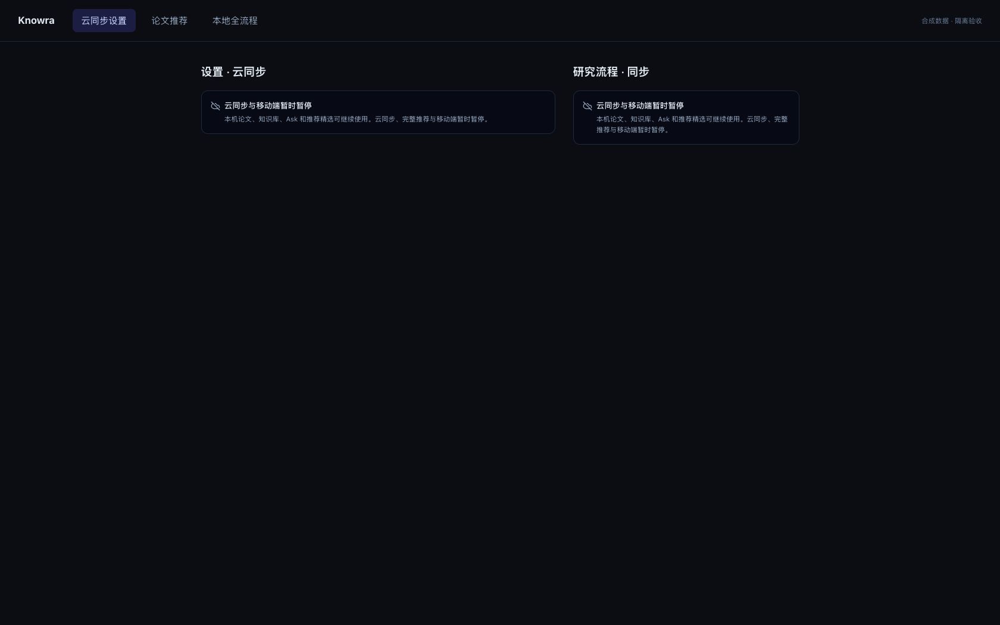

# PR #34 合并 #33 后的验收

原 [PR #34](https://github.com/vince-xunzhe/Knowra/pull/34) 已正常合并用户合入的 [PR #33](https://github.com/vince-xunzhe/Knowra/pull/33)，保留索骥整理布局和云冻结。

- 最新基线：`5fa246f7afcfb63532ae8503f0dcf3b570140797`（#33 于 2026-10-28 合并）。
- **受测合并代码：`c9375f70fbc3cd7e5c2ca120724bc8b9ae7454c6`**，两个 parent 为原 PR #34 `5f5ba2f` 和新主线 `5fa246f`，没有 rebase 或 force push。
- 检查在解决冲突后的未提交合并树上运行。提交前后逐项核对 336 个运行／测试文件 SHA-256 不变；真实启动 325 项源码、云冻结 128 项源码和布局快照 127 项前端文件与提交逐字节一致。统一快照仅按原 runner 规则调整两项 TypeScript 缓存位置。参见 [源码对应记录](source-manifest.json) 与 [验收汇总](verification.json)。之后只补 DOD 与开发日志。

## 冲突处理

唯一文本冲突是 `DEVELOPMENT_LOG.md`：保留布局与云冻结两条记录，补本次合并记录，并将 #33 更新为已合并。三种翻译文件保留双方全部键值；`scripts/check_frontend.py` 同时保留 main 的策略快照结构和布局／几何单测入口，共 22 项。

另外修复语义兼容：`scripts/check_domain_layout.py` 的隔离源码改放 `workspace/frontend`，同级放 `cloud-capabilities.json`，让云冻结新增的相对导入在布局专项中成立。基线策略只读取指定 Git 提交，旧基线无策略时保持缺省；没有注入当前策略、改动生产云行为或放宽网络边界。

#33 的 44 个非共享文件与 main 完全一致，双方原 DOD、截图和测试均保留。独立只读审查确认无阻断项。

## 新主线上的合成图证据

全部是原始浏览器截图，23 篇虚构论文、42 条虚构关系，包含环、多个分量、长标题、手工关系、锁定、分组和备注。未发布用户参考图。

| 新 main 基线 | 合并后应用布局 |
| --- | --- |
| [](before-baseline.png) | [](after-applied.png) |

卡片重叠 **4→0**，每条路径 220 点采样的“边—非端点卡片”相交对 **48→0**，全部论文及关系保留。此计数不代表关系条数，也不表示所有边交叉和标签重叠消失。[基线结果](baseline-results.json) · [8 组布局交互结果](browser-results.json) · [预览](after-preview.png) · [锁定手工关系](after-edge-detail.png) · [保存失败恢复](after-save-failure.png)。

[](after-cloud-paused.png)

## Definition of Done 与实际验证

- [x] 原 PR #34、原分支正常合并 main，双方历史、代码、测试、日志和 DOD 保留。
- [x] 合并后完整统一检查通过：29 项启动夹具、58 项隔离后端、22 项前端单测、类型／构建、完整 ESLint 零错误零警告、5 项生命周期 UI。
- [x] `--real-start` 通过：合成已有库的记录保留、旧列恢复、排队任务不执行；API 关闭钩子完成，API／Web／夹具推荐 worker 无残留进程或端口。
- [x] 布局 8 组交互与新 main 基线通过：预览／对照／取消、锁定／语义保留、重复整理、撤销重做、未保存编辑、503 重试、409 不自动覆盖、领域／页面切换与外部更新。
- [x] 云冻结 8 组、31 个直接入口通过；9 组合成 storage 状态均无改写，外网尝试与违规为零，测试服务正常清理。
- [x] 独立合并审查、截图像素检查、公共文件隐私检查、源码与受测树对应检查通过。

命令均在专属 worktree `/tmp/knowra-suoji-layout-20261028` 执行，Node 显式选择 24.14.1：

```sh
NODE_BIN=/Users/vince/.local/lib/node-v24.14.1-darwin-arm64/bin/node ./scripts/check.sh --real-start
NODE_BIN=/Users/vince/.local/lib/node-v24.14.1-darwin-arm64/bin/node backend/.venv/bin/python scripts/check_cloud_freeze.py
PATH=/Users/vince/.local/lib/node-v24.14.1-darwin-arm64/bin:/opt/homebrew/bin:/usr/bin:/bin backend/.venv/bin/python scripts/check_domain_layout.py
PATH=/Users/vince/.local/lib/node-v24.14.1-darwin-arm64/bin:/opt/homebrew/bin:/usr/bin:/bin backend/.venv/bin/python scripts/check_domain_layout.py --baseline 5fa246f7afcfb63532ae8503f0dcf3b570140797
```

[前端检查结果](frontend-results.json) · [22 项单测原始输出](unit-results.txt) · [云冻结结果](cloud-results.json) · [真实启动与清理结果](native-start-results.json)。环境为 macOS 26.5.1、Python 3.12.13、Node 24.14.1、Vite 8.0.10、TypeScript 6.0.3、Chrome 156.0.8078.48；继续使用本 worktree 的 `backend/.venv`、`frontend/node_modules`、`.cache`。

## 隔离与限制

布局／云冻结专项仅静态回环页面、全 mock API 和临时浏览器 profile，未启动后端或打开数据库。真实启动仅使用本 worktree 缓存中新建的合成 SQLite／源码快照，真实 API/Web 端口 54743／54744；排队任务禁用，测试推荐 worker 受合成租约保护，正常关闭后均无残留。未打开、迁移、同步或改写日常数据库和论文，未刷新用户页面、停止已有服务、改原 main、云账户或订阅。

本报告是本地验收，不等于 GitHub CI；未验证真实研究数据、真实模型、跨浏览器、完整应用 E2E、PostgreSQL RLS、移动端或部署。固定分组内部不重排；固定元素原有重叠只报告。大图或路径搜索预算耗尽时提示简化路径，保留全部关系但可能穿卡；低缩放密集标签仍可能重叠。未 merge PR、未部署，用户负责合并。
