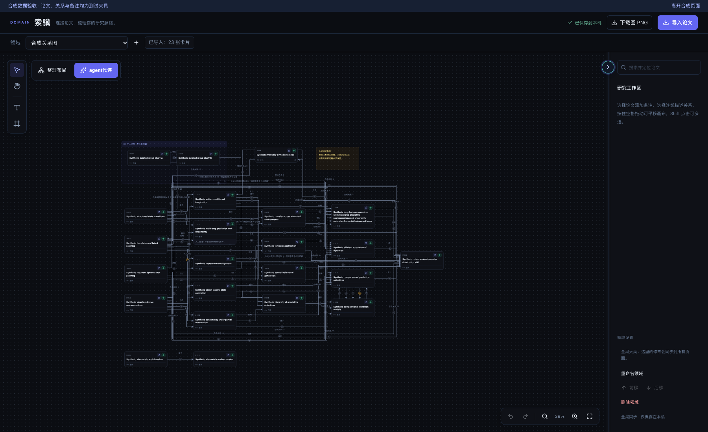
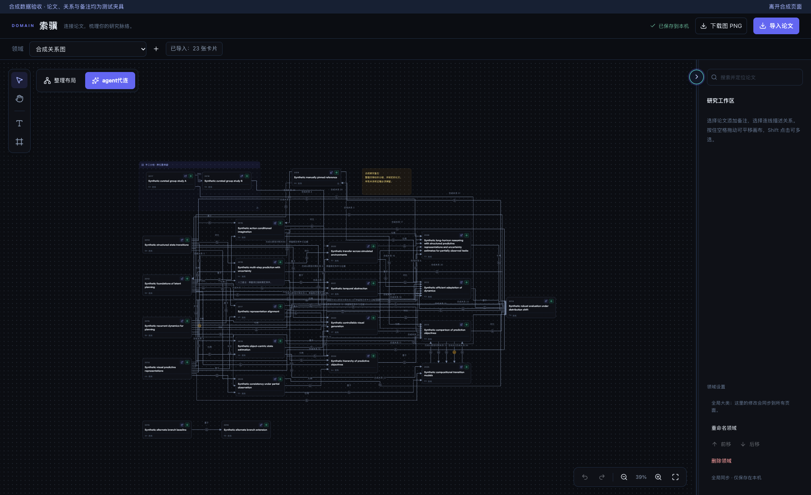
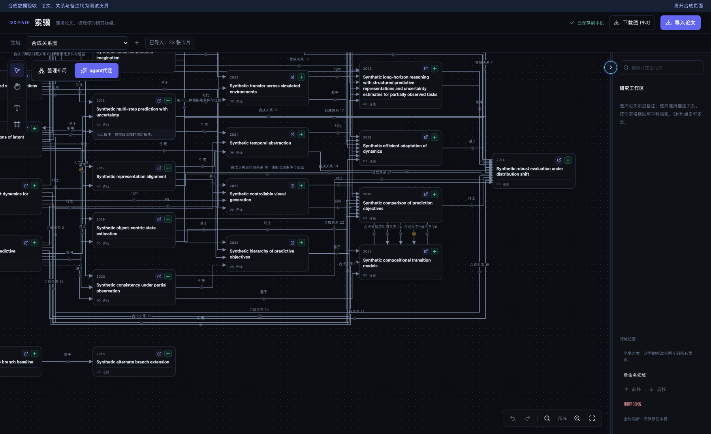
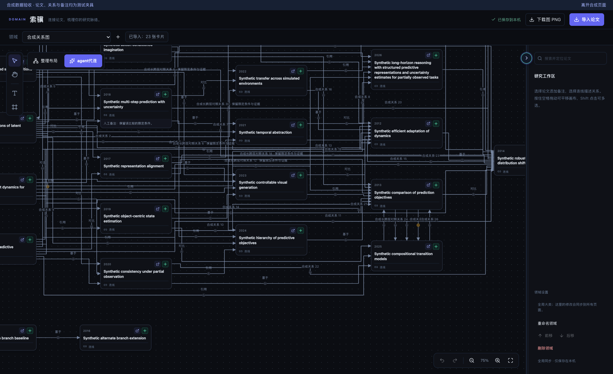

# 索骥整理布局：连线疏朗优化 DOD

交付：[PR #36](https://github.com/vince-xunzhe/Knowra/pull/36)，非 Draft，等待用户合并。

保留原“整理布局”入口、预览／对照／取消／应用／撤销和全部论文关系。本轮按局部拥挤程度留出节点空间，并将长距离共线和近并行路径分散到不同通道；没有删边、隐藏边或调用 LLM。

- 日期：2026-10-28。新工作树 `/tmp/knowra-suoji-layout-spacing-20261028`（解析为 `/private/tmp/knowra-suoji-layout-spacing-20261028`），分支 `codex/suoji-layout-spacing-20261028`。
- freshly fetched 基线 **`a392c6f56ccb20ea6ebdf6e41a0e9c063e94276b`**；已核实 [#34](https://github.com/vince-xunzhe/Knowra/pull/34) 于本日合并为 `1291cc4`，[#35](https://github.com/vince-xunzhe/Knowra/pull/35) 于本日合并为 `a392c6f`，高亮已包含在基线。
- **受测代码：`5a33566e05cc573fa89b00029221c19ed05eaa4f`**。检查在完整待提交工作树运行，提交前后 343 项运行／测试源码 SHA-256 完全一致；原始 runner 的 `source_head` 保留当时基线，没有冒称执行时 HEAD 已是新提交。后续只补证据／日志。[源码对应记录](source-manifest.json) · [双版本快照哈希](layout-snapshot-source.json) · [验证汇总](verification.json)。

## 同一图、同一视窗

同一合成图有 **23 篇虚构论文、25 个节点、74 条关系**，包含长跳层、环、反向／平行边、多个分量、锁定节点／边、固定分组、备注和长标签。两版都先实际点击“整理布局→应用”，比较旧版整理后的结果和新版整理后的结果。

以下均为 **1800×1100 原始浏览器截图**，没有裁剪、拼图或图像生成。概览统一 **39%**、相同平移 `(285.06, -137.11)`，视窗由两图节点及路径范围的并集确定；两图全节点／全路径均无裁切。没有使用不同缩放掩盖画布增长。

| 基线整理后 | 新版整理后 |
| --- | --- |
|  |  |

下列局部图统一 **75%**、相同平移 `(-163, -984)`，用于看通道细节，须配合上方完整概览。两图左侧裁切 118px、顶部裁切 286.5px；新版右侧另裁切 119px，完整记录在 [原始指标](layout-comparison.json)。

| 基线 75% 局部 | 新版 75% 局部 |
| --- | --- |
|  |  |

## 实测改善及代价

独立指标直接读取真实 DOM 尺寸和实际 SVG `M/L` 路径，不调用路由内部评分。核心段从每条路径两端各裁去 24 个世界像素，完整路径指标保留全部端点短线；共线容差 0.5px，近并行要求纵向重叠至少 24px，并分别统计距离小于 12／20px。长度均为世界像素，按边对累计，可能大于所有路径长度之和。共同端点边对的交叉单独计数，并与非共端点交叉相加。

| 指标 | 基线 | 新版 |
| --- | ---: | ---: |
| 论文／关系 | 23／74 | 23／74 |
| 卡片重叠 | 0 | 0 |
| 核心段共线重合长度 | 13,103.66 | **8,648.91（−34.0%）** |
| 核心段近并行长度（<12px） | 51,493.53 | **15,934.92（−69.1%）** |
| 核心段非共端点／共端点交叉次数 | 303／155 | 277／107 |
| 核心段交叉总次数 | 458 | 384 |
| 完整路径交叉总次数 | 542 | **475（−12.4%）** |
| 连线穿过非端点卡片的相交对 | 4 | **0** |
| 可移动卡片最小间隙 | 72px | 90px |
| 连线与非端点卡片最小距离 | 0px | 12px |
| 节点＋路径包围面积 | 3,101,700 | 3,745,388（+20.8%） |
| 总路径长度 | 64,300.66 | 69,101.48（+7.5%） |
| 最长路径 | 2,399.71 | 2,724.71（+13.5%） |
| 总折点数 | 186 | 208 |
| 理论适配缩放 | 55% | 51% |

**取舍：发生交叉的不同非共端点边对数没有全部下降。** 核心段 261→262，完整路径 290→310；交叉点总次数降低，但涉及交叉的关系对更多。中心仍有线束，长标签仍可能相互叠压，39% 下不能直接读清所有标签。未宣称消除全部拥挤或交叉。

[完整指标与 20 项质量门槛](layout-comparison.json) · [基线实际几何](before-arranged-geometry.json) · [新版实际几何](after-arranged-geometry.json)。门槛同时约束共线／近并行改善、各类交叉不增、无新增穿卡、面积≤1.5倍、总路长≤1.25倍、最长路≤1.5倍、折点≤1.25倍、适配缩放≥0.8倍；不是仅凭截图判断更美观。

## Definition of Done

- [x] 实际查看本轮用户参考图，针对外侧长线束、窄通道和端口拥挤诊断；私有参考图未发布。
- [x] 新 fetch、新 worktree／分支，保留原 main、旧工作树及已合并 PR；兼容已合并高亮与云冻结。
- [x] 局部层间距 170–250px、行间距 72–120px；繁忙区域适度增加，稀疏区域保持尺寸。局部上限不代表任意多组件／固定障碍画布都满足同一全图面积比例。
- [x] 确定性拥挤评分、有限换通道搜索及邻卡安全出口；不丢边、改关系、改证据或移动锁定／分组／备注。
- [x] 预览／取消、应用、重复稳定、撤销／重做、手工关系、未保存备注、503／409、领域／页面切换、外部刷新和 Agent 只读均保持。
- [x] 同图同视窗对照通过，全部路径均存在且可见；透明路径和透明父元素的自检必须被检测拒绝。
- [x] 统一回归、专项、高亮、云冻结及独立源码／像素审查通过，公开文件经过范围／隐私审查。
- [x] 所有浏览器／静态服务正常清理，无外网违规，没有操作用户已有服务或日常数据。

## 实际检查与环境

| 检查 | 实际结果 |
| --- | --- |
| `install-native.sh` | 独立环境安装通过，无依赖升级；官方哈希 wheel 与 npm lock，禁用生命周期脚本 |
| `start.sh --check`（API 8119／Web 5199） | 通过，仅预检；未启动服务 |
| `scripts/check.sh` | 29 项启动夹具、58 项隔离后端通过 |
| 前端单测 | **33 项通过**：polling 5、layout 12、geometry 13、独立指标 3 |
| TypeScript／Vite／完整 ESLint | 通过，ESLint 零错误零警告 |
| 既有生命周期 UI | 5 项通过 |
| `check_domain_layout.py --compare a392c6f56ccb20ea6ebdf6e41a0e9c063e94276b` | 两版构建、9 组浏览器流程、20 项质量门槛通过 |
| `check_domain_highlight.py` | 10 组通过，保留选择／动画／减少动画／布局预览等行为 |
| `check_cloud_freeze.py` | 8 组与 31 个直接入口通过，外网尝试／违规为零 |
| 独立代码与四图视觉审查 | 无未解决阻断项 |

[统一检查原始结论](unified-summary.txt) · [33 项单测输出与性能诊断](unit-results.txt) · [前端结果](frontend-results.json) · [布局结果](layout-results.json) · [高亮结果](highlight-results.json) · [云冻结结果](cloud-results.json)。[合成图高亮截图](highlight-after.png) 确认路径优化与已有高亮兼容。

环境：macOS 26.5.1，Python 3.12.13，Node 24.14.1，Vite 8.0.10，TypeScript 6.0.3，Chrome 156.0.8078.48。使用本工作树 `backend/.venv`、`frontend/node_modules` 和 `.cache`；浏览器使用临时 profile，静态监听随机回环端口，所有业务 API 在内存中 mock。`NODE_BIN=/Users/vince/.local/lib/node-v24.14.1-darwin-arm64/bin/node` 用于统一与云检查；布局／高亮 runner 通过 PATH 选择同一 Node。

## 修复记录、数据边界和限制

首轮单通道拥挤评分在固定网格单测改善，却在更真实的 74 边已整理图中使共线长度增加约 60%，因此未交付。实际几何指出跨列卡片错位后只剩约 7px 的有效横向走廊。复用已有避障搜索加入有界换通道，并记录短端口的交叉成本，修复后重新通过所有质量门槛。另修复端点短线伸入近邻固定卡片导致回退穿卡，新增四个方向、24／32／40／48px 间距及自环回归。没有更换弱夹具、删除关系或放宽失败门槛。

生产改动仅 `domainLayout.ts` 与 `domainGeometry.ts`。其余为合成夹具、指标与回归、隔离双版本验收 runner，以及两个单测入口。未修改高亮、云鉴权／同步、识途、后端、依赖锁或启动行为。

没有读取、打开、迁移、同步或修改日常数据库、论文或配置；用户参考图仅通过受支持 Library 流程复制到私有缓存供分析。统一检查使用维护中的隔离源码／合成数据守卫；专项没有真实后端或数据库，没有刷新用户页面、停止用户服务或更改账户／订阅。

局部间距及搜索有上限，不保证所有图的所有交叉指标同步减少。超过 200 个非分组节点或 800 条关系时保留已有显式简化路径；拥挤比较预算耗尽保留有效路线，极窄固定间隙仍可能无法满足避障留白。单测性能是合成函数测量，不承诺完整浏览器帧率。

未验证真实研究数据、真实模型、跨浏览器、完整应用 E2E、PostgreSQL RLS、移动端、CI 或部署。本轮没有原生启动改动，未运行 `--real-start`；未 merge PR、未部署，由用户合并。
